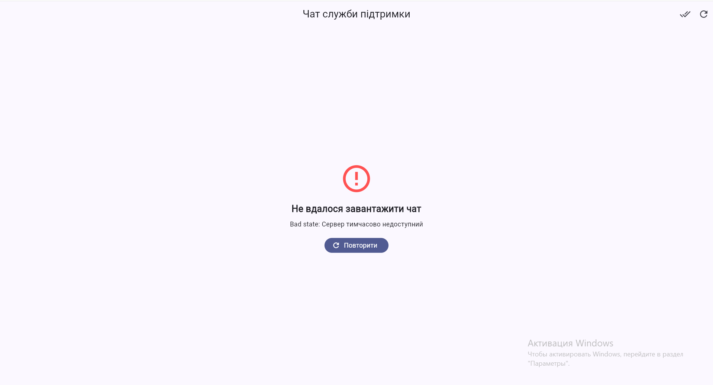
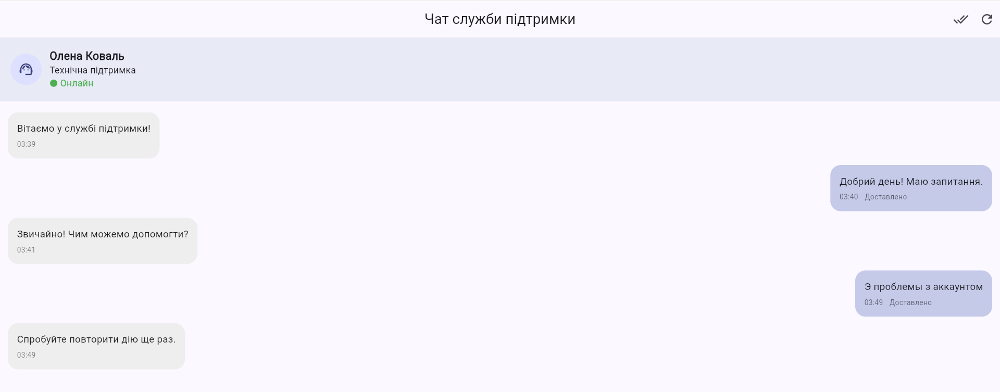
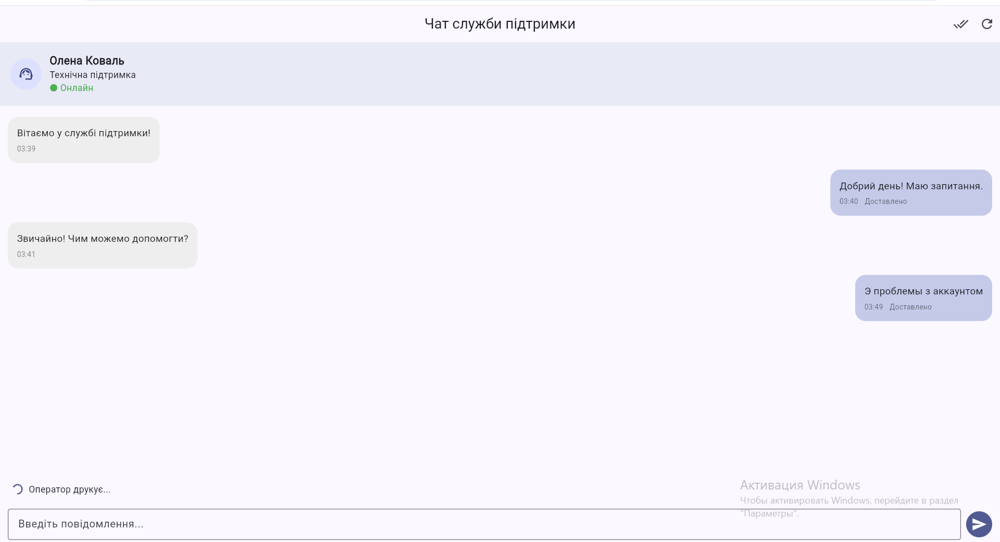

# Чат служби підтримки

## Практична робота №8

**Тема:** Робота з асинхронним кодом у Dart.

**Варіант №2:** Чат служби підтримки.

## Опис проєкту

Flutter-застосунок, який імітує роботу чату між користувачем та оператором служби підтримки.

Застосунок демонструє асинхронне завантаження даних, надсилання повідомлень, обробку помилок, роботу з потоками та оновлення інтерфейсу в реальному часі.

## Функціональні можливості

- Завантаження історії повідомлень та профілю оператора.
- Паралельне виконання запитів через `Future.wait`.
- Відображення станів завантаження, помилки, порожньої історії та успішного отримання даних.
- Надсилання повідомлень із відображенням статусів.
- Повторне надсилання повідомлень після помилки.
- Автоматичні відповіді оператора із затримкою 2–5 секунд.
- Індикатор «Оператор друкує...».
- Лічильник непрочитаних повідомлень.
- Позначення повідомлень як прочитаних.
- Оновлення чату.
- Імітація мережевих помилок.

## Використані асинхронні механізми

### FutureBuilder

Використовується у `lib/screens/chat_screen.dart` для початкового завантаження даних.

`Future` створюється поза методом `build()`.

### Future.wait

Використовується у `lib/services/fake_chat_api.dart` для паралельного завантаження історії повідомлень та профілю оператора.

### Future.delayed

Використовується у `FakeChatApi` для імітації мережевих затримок.

### TimeoutException

Метод надсилання повідомлення використовує `.timeout()`. Якщо час виконання перевищує встановлений ліміт, повідомлення отримує статус «Не доставлено».

### StreamController.broadcast()

Використовується у `lib/services/chat_controller.dart`.

Один потік повідомлень має два незалежні слухачі:

1. `StreamBuilder` для списку повідомлень.
2. `StreamBuilder` для лічильника непрочитаних повідомлень.

Якщо замінити `StreamController.broadcast()` на звичайний `StreamController()`, другий слухач спричинить помилку `Bad state: Stream has already been listened to`, оскільки звичайний потік підтримує лише одного слухача.

### dispose()

У `ChatController` закривається `StreamController` та звільняється `ValueNotifier`.

У `ChatScreen` звільняється `TextEditingController` і контролер чату.

Після завершення асинхронних операцій виконуються перевірки актуальності стану, щоб уникнути звернення до знищених компонентів.

## Структура проєкту

```text
lib/
├── main.dart
├── models/
│   ├── chat_message.dart
│   ├── support_operator.dart
│   └── chat_initial_data.dart
├── services/
│   ├── fake_chat_api.dart
│   └── chat_controller.dart
└── screens/
    └── chat_screen.dart
```

## Запуск застосунку

Встановити Flutter SDK та виконати команди:

```bash
flutter pub get
flutter run -d chrome
```

## Перевірка коду

```bash
dart format lib
flutter analyze
```

## Скріншоти роботи застосунку

### 1. Обробка помилки

Відображення повідомлення про помилку мережевого запиту з можливістю повторного завантаження даних.



### 2. Основний інтерфейс чату

Відображення історії повідомлень, інформації про оператора, поля введення та статусів надсилання.



### 3. Оновлення повідомлень у реальному часі

Демонстрація отримання відповіді оператора, оновлення списку повідомлень через `StreamBuilder` та зміни лічильника непрочитаних повідомлень.


